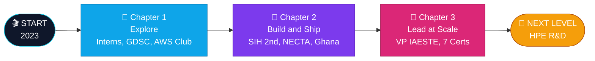
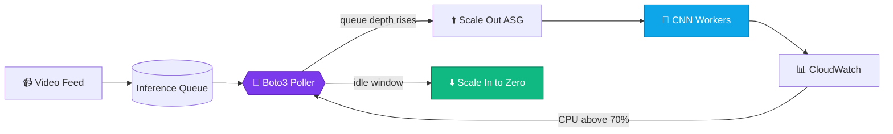

<div align="center">


<p align="center">
  <a href="https://palakkumari-er.netlify.app/"></a>
  <a href="https://www.linkedin.com/in/palakkumari0604/"></a>
  <a href="https://codolio.com/profile/Palak954"></a>
  <a href="mailto:palakkumari1232604@gmail.com"></a>
</p>

<p align="center">
  
</p>

</div>

---

## 🎮 Player Card

<table width="100%">
<tr>
<td width="50%" valign="top">

**👩‍💻 Player:** Palak Kumari<br/>
**🧙 Class:** Cloud Engineer / Backend Mage<br/>
**🏰 Guild:** IAESTE LC JECRC (Vice President)<br/>
**📍 Home base:** JECRC University, Jaipur<br/>
**🎯 Next zone:** HPE R&D, Bengaluru<br/>
**🧰 Loadout:** Java · AWS · Python · .NET<br/>
**🌱 Side quest:** Open source (GSSoC'24, SSoC'25)<br/>
**🟢 Status:** Open to collabs and talks

</td>
<td width="50%" valign="top">

❤️ **HP** &nbsp;&nbsp;🟩🟩🟩🟩🟩🟩🟩🟩⬜⬜ &nbsp;CGPA 8.36<br/>
⚡ **MP** &nbsp;&nbsp;🟦🟦🟦🟦🟦🟦🟦⬜⬜⬜ &nbsp;7 certifications<br/>
🧠 **INT** &nbsp;🟪🟪🟪🟪🟪🟪🟪🟪🟪⬜ &nbsp;839+ DSA solved<br/>
👑 **CHA** &nbsp;🟨🟨🟨🟨🟨🟨🟨🟨🟨⬜ &nbsp;46+ members led<br/>
🔥 **STR** &nbsp;🟧🟧🟧🟧🟧🟧🟧🟧⬜⬜ &nbsp;80-day streak

</td>
</tr>
</table>

<div align="center">

| 💰 **17.5 LPA** | 📜 **7x** | 🧩 **839+** | 👥 **46+** | 🌍 **3 continents** | 📣 **177K+** |
|:---:|:---:|:---:|:---:|:---:|:---:|
| HPE R&D Offer | Certifications | DSA Problems | Members Led | Remote Teams | Content Reach |

</div>

---

## ⚔️ Skill Tree

<div align="center">


<br/>


<br/><br/>

| Skill | Level | |
|:---|:---|---:|
| ☕ **Java and DSA** | 🟪🟪🟪🟪🟪🟪🟪🟪🟪⬜ | **92%** |
| ☁️ **AWS and Cloud** | 🟦🟦🟦🟦🟦🟦🟦🟦🟦⬜ | **90%** |
| ⚙️ **Backend (.NET / Python)** | 🟩🟩🟩🟩🟩🟩🟩🟩🟩⬜ | **88%** |
| 👁️ **Computer Vision / AI** | 🟧🟧🟧🟧🟧🟧🟧🟧⬜⬜ | **84%** |

</div>

<details>
<summary><b>🎒 Open full inventory</b></summary>
<br/>

| Slot | Items |
|---|---|
| ☁️ **Cloud** | `EC2` `Auto Scaling` `S3` `IAM` `Lambda` `CloudWatch` `Boto3` `CI/CD` |
| ⚙️ **Backend** | `Java SE 21` `C# .NET MVC` `Django` `Node/Express` `REST APIs` |
| 🗄️ **Data** | `SQL Server` `MySQL` `MongoDB` `Pandas` `Matplotlib` `Microsoft Fabric` |
| 🤖 **AI / Vision** | `OpenCV` `Keras` `CNNs` `TensorFlow` |
| 🌐 **Other** | `ServiceNow CIS` `JNCIA-Junos` `Leaflet` `PWA` |

</details>

---

## 🗺️ Quest Log



<details>
<summary><b>📜 Work experience (click to expand)</b></summary>
<br/>

| ⚔️ Role | 📍 Where | 🏅 Impact |
|---|---|---|
| **Full Stack Dev Intern** | NECTA, Tanzania 🇹🇿 | Rebuilt .NET billing: **-40% invoice time**, fixed **5,000+ records** |
| **Backend and Data Intern** | AkooBooks Audio, Ghana 🇬🇭 | **+25% page speed**, **+30% engagement**, **-20%** manual ops |
| **Web Dev Intern** | DevBox Technologies, Jaipur 🇮🇳 | Shipped **5+ client sites**, fixed **30+ bugs** |
| **Data Science Intern** | Psyliq, Remote | Dashboards that boosted reporting efficiency **+30%** |

</details>

---

## 🏰 Featured Projects

<table width="100%">
<tr>
<td width="50%" valign="top">

### 🤟 ISL Real-Time Converter
🏆 *Smart India Hackathon 2nd Prize*

Translates Indian Sign Language finger-spelling into **text and speech** in real time.

- 🎯 **94.8%** accuracy across 26 classes
- ⚡ **30+ FPS** on edge devices
- 🧠 Custom CNN + OpenCV pipeline

`Python` `OpenCV` `Keras`

[**⚔️ View Code**](https://github.com/palakpk954/ISL-Converter-)

</td>
<td width="50%" valign="top">

### ☁️ AWS Auto-Scaling Inference
⚙️ *Cloud Automation*

Boto3 automation that scales EC2 inference workers with incoming video load.

- 💸 **-65%** idle compute cost
- 🛡️ **99.9%** uptime with failover
- 🔐 IAM least-privilege design

`AWS` `Boto3` `CloudWatch`

[**⚔️ View Code**](https://github.com/palakpk954/AWS-automation)

</td>
</tr>
<tr>
<td width="50%" valign="top">

### 🎯 Placement Helper: "You Can"
🌐 *Live in production*

Interview-prep platform for engineering students.

- 👥 Used by hundreds of students
- 📚 Java, DSA, OS, DBMS, System Design
- 🌙 Mobile-first with dark mode

`JavaScript` `REST APIs` `Render`

[**🚀 Live Demo**](https://placement-helper-you-can-1.onrender.com/) · [**⚔️ Code**](https://github.com/palakpk954/Placement_Helper-You_Can-)

</td>
<td width="50%" valign="top">

### 🌧️ Landslide Early-Warning
🥇 *Regional Hackathon Top 10*

Map dashboard that triggers evacuation alerts from rainfall thresholds.

- 🗺️ Leaflet + GeoJSON risk overlays
- 📶 Works in low-bandwidth zones
- 🔄 Offline-first with service workers

`JavaScript` `Leaflet` `PWA`

[**⚔️ View Code**](https://github.com/palakpk954/regional-risk-project)

</td>
</tr>
</table>

<div align="center">

🚚 **Side quest:** [Transport and Logistics Management System](https://github.com/palakpk954/transport_management) · Django · ACID bookings · dispatch scheduling

</div>

<details>
<summary><b>🧬 How the AWS auto-scaler thinks (click to expand)</b></summary>



</details>

---

## 🏆 Achievements Unlocked

<table width="100%" align="center">
<tr>
<td align="center" width="33%">🥈 <b>SIH 2nd Rank</b><br/><sub>300+ national teams</sub></td>
<td align="center" width="33%">💰 <b>HPE R&D Offer</b><br/><sub>17.5 LPA, Bengaluru</sub></td>
<td align="center" width="33%">💼 <b>HCL Tech Offer</b><br/><sub>Java Developer</sub></td>
</tr>
<tr>
<td align="center">☁️ <b>AWS x3 Certified</b><br/><sub>Architect · Developer · Practitioner</sub></td>
<td align="center">☕ <b>Oracle Java SE 21</b><br/><sub>1Z0-830</sub></td>
<td align="center">📊 <b>MS Fabric Data Engineer</b><br/><sub>Associate</sub></td>
</tr>
<tr>
<td align="center">🛠️ <b>ServiceNow CIS</b><br/><sub>Data Foundation</sub></td>
<td align="center">🌐 <b>JNCIA-Junos</b><br/><sub>HPE Juniper Networks</sub></td>
<td align="center">🗽 <b>SheFi Scholar</b><br/><sub>Brooklyn, NYC</sub></td>
</tr>
<tr>
<td align="center">🎓 <b>Amazon ML Summer School</b><br/><sub>2026</sub></td>
<td align="center">🔷 <b>McKinsey Forward</b><br/><sub>Alumna</sub></td>
<td align="center">🌟 <b>LinkedIn 4x Top Voice</b><br/><sub>11.8k followers</sub></td>
</tr>
</table>

<details>
<summary><b>👑 Guild leadership (click to expand)</b></summary>
<br/>

- **Vice President, IAESTE LC JECRC:** 46+ team, 29 global interns hosted, 36+ offers released
- **Management Lead, AWS Cloud Club JU:** university-wide cloud bootcamps
- **Tech Masters India:** national community lead
- **Founder, Brify:** tech freelancing for small businesses
- **Open source:** GSSoC'24 and SSoC'25 contributor

</details>

---

## 📈 Battle Stats

<div align="center">


</div>

### 🧩 Codolio coding profile

<div align="center">

<a href="https://codolio.com/profile/Palak954">
  
</a>

<br/><br/>

| 🟢 Easy | 🟡 Medium | 🔴 Hard | 🔥 Max streak | ⭐ LeetCode rating | 📅 Active days |
|:---:|:---:|:---:|:---:|:---:|:---:|
| **320** (38%) | **415** (49%) | **104** (13%) | **80 days** | **1500** | **264** |

<a href="https://codolio.com/profile/Palak954"></a>

</div>

---

## 💀 The Hidden Level

```diff
- Rejected by multiple companies.
- Failed contest submissions. Late-night debugging sessions nobody saw.
+ Practiced more. Built more. Applied again.
+ Outcome: HPE R&D and HCL Tech.
```

> *Technical resilience is the most important skill an engineer can possess.*

---

## 📡 Ready Player Two?

I'm open to **engineering roles, tech talks, open-source collabs, and student mentorship.**

<div align="center">

<a href="https://palakkumari-er.netlify.app/"></a>
<a href="https://www.linkedin.com/in/palakkumari0604/"></a>
<a href="https://codolio.com/profile/Palak954"></a>
<a href="mailto:palakkumari1232604@gmail.com"></a>


</div>
