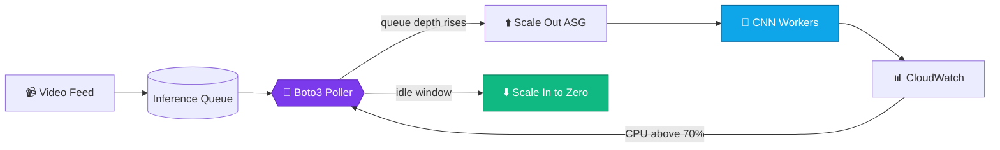

<div align="center">


<br/>

<a href="https://palakkumari-er.netlify.app/"></a>
<a href="https://www.linkedin.com/in/palakkumari0604/"></a>
<a href="https://codolio.com/profile/Palak954"></a>
<a href="mailto:palakkumari1232604@gmail.com"></a>

<br/>


</div>

## 🎮 Player Card

<table>
<tr>
<td width="55%" valign="top">

```yaml
PLAYER:     Palak Kumari
CLASS:      Cloud Engineer / Backend Mage
GUILD:      IAESTE LC JECRC (Vice President)
HOME BASE:  JECRC University, Jaipur
NEXT ZONE:  HPE R&D, Bengaluru
LOADOUT:    Java · AWS · Python · .NET
SIDE QUEST: Open source (GSSoC'24, SSoC'25)
STATUS:     🟢 Open to collabs and talks
```

</td>
<td width="45%" valign="top">

```text
❤️ HP  ██████████ CGPA 8.36/10
⚡ MP  ██████████ 7 certifications
🧠 INT █████████░ 839+ DSA solved
👑 CHA █████████░ 46+ members led
🔥 STR ████████░░ 80-day streak
```

</td>
</tr>
</table>

<div align="center">

| 💰 **17.5 LPA** | 📜 **7x** | 🧩 **839+** | 👥 **46+** | 🌍 **3 continents** | 📣 **177K+** |
|:---:|:---:|:---:|:---:|:---:|:---:|
| HPE R&D Offer | Certifications | DSA Problems | Members Led | Remote Teams | Content Reach |

</div>

<div align="center"></div>

## ⚔️ Skill Tree

<div align="center">


<br/><br/>


<br/>


</div>

<details>
<summary><b>🎒 Open full inventory</b></summary>
<br/>

| Slot | Items |
|---|---|
| ☁️ **Cloud** | `EC2` `Auto Scaling` `S3` `IAM` `Lambda` `CloudWatch` `Boto3` `CI/CD` |
| ⚙️ **Backend** | `Java SE 21` `C# .NET MVC` `Django` `Node/Express` `REST APIs` |
| 🗄️ **Data** | `SQL Server` `MySQL` `MongoDB` `Pandas` `Matplotlib` `Microsoft Fabric` |
| 🤖 **AI / Vision** | `OpenCV` `Keras` `CNNs` `TensorFlow` |
| 🌐 **Other** | `ServiceNow CIS` `JNCIA-Junos` `Leaflet` `PWA` |

</details>

<div align="center"></div>

## 🗺️ Quest Log


<details>
<summary><b>📜 Active quests: work experience</b></summary>
<br/>

| ⚔️ Quest | 📍 Realm | 🏅 Loot |
|---|---|---|
| **Full Stack Dev Intern** | NECTA, Tanzania 🇹🇿 | Rebuilt .NET billing: **-40% invoice time**, fixed **5,000+ records** |
| **Backend and Data Intern** | AkooBooks Audio, Ghana 🇬🇭 | **+25% page speed**, **+30% engagement**, **-20%** manual ops |
| **Web Dev Intern** | DevBox Technologies, Jaipur 🇮🇳 | Shipped **5+ client sites**, squashed **30+ bugs** |
| **Data Science Intern** | Psyliq, Remote | Dashboards that boosted reporting efficiency **+30%** |

</details>

<div align="center"></div>

## 🏰 Boss Fights: Featured Projects

<table>
<tr>
<td width="50%" valign="top">

### 🤟 ISL Real-Time Converter
**Boss level:** 🏆 *SIH 2nd Prize*

Real-time sign language to **text and speech**.

```text
ACCURACY  ████████████████████ 94.8%
SPEED     30+ FPS on edge devices
WEAPONS   Python · OpenCV · Keras CNN
```

[⚔️ **View Code**](https://github.com/palakpk954/ISL-Converter-)

</td>
<td width="50%" valign="top">

### ☁️ AWS Auto-Scaling Inference
**Boss level:** ⚙️ *Cloud Automation*

Boto3 scales EC2 workers with video load.

```text
COST CUT  █████████████░░░░░░░ -65%
UPTIME    99.9% with auto failover
WEAPONS   AWS · Boto3 · CloudWatch
```

[⚔️ **View Code**](https://github.com/palakpk954/AWS-automation)

</td>
</tr>
<tr>
<td width="50%" valign="top">

### 🎯 Placement Helper: "You Can"
**Boss level:** 🌐 *Live in production*

Interview-prep hub for engineering students.

```text
USERS     Hundreds of students
TOPICS    Java · DSA · OS · DBMS · SysDesign
WEAPONS   JavaScript · REST · Render
```

[🚀 **Live Demo**](https://placement-helper-you-can-1.onrender.com/) · [⚔️ **Code**](https://github.com/palakpk954/Placement_Helper-You_Can-)

</td>
<td width="50%" valign="top">

### 🌧️ Landslide Early-Warning
**Boss level:** 🥇 *Regional Hackathon Top 10*

Rainfall-triggered evacuation alerts on a map.

```text
MODE      Offline-first PWA
MAPS      Leaflet + GeoJSON overlays
WEAPONS   JavaScript · Service Workers
```

[⚔️ **View Code**](https://github.com/palakpk954/regional-risk-project)

</td>
</tr>
</table>

<div align="center">

🚚 **Side quest:** [Transport and Logistics Management System](https://github.com/palakpk954/transport_management): Django, ACID bookings, dispatch scheduling

</div>

### 🧬 Boss mechanics: how the auto-scaler thinks



<div align="center"></div>

## 🏆 Achievements Unlocked

<div align="center">

| | | |
|:---:|:---:|:---:|
| 🥈 **SIH 2nd Rank**<br/><sub>300+ national teams</sub> | 💰 **HPE R&D Offer**<br/><sub>17.5 LPA, Bengaluru</sub> | 💼 **HCL Tech Offer**<br/><sub>Java Developer</sub> |
| ☁️ **AWS x3 Certified**<br/><sub>SA · Developer · Practitioner</sub> | ☕ **Oracle Java 21**<br/><sub>1Z0-830</sub> | 📊 **MS Fabric DE**<br/><sub>Data Engineer Associate</sub> |
| 🛠️ **ServiceNow CIS**<br/><sub>Data Foundation</sub> | 🌐 **JNCIA-Junos**<br/><sub>HPE Juniper</sub> | 🗽 **SheFi Scholar**<br/><sub>Brooklyn, NYC</sub> |
| 🎓 **Amazon ML Summer School 2026** | 🔷 **McKinsey Forward**<br/><sub>Alumna</sub> | 🌟 **LinkedIn 4x Top Voice**<br/><sub>11.8k followers</sub> |

</div>

<details>
<summary><b>👑 Guild leadership</b></summary>
<br/>

- **Vice President, IAESTE LC JECRC**: 46+ team, 29 global interns hosted, 36+ offers released
- **Management Lead, AWS Cloud Club JU**: university-wide cloud bootcamps
- **Tech Masters India**: national community lead
- **Founder, Brify**: tech freelancing for small businesses
- **Open source**: GSSoC'24 and SSoC'25 contributor

</details>

<div align="center"></div>

## 📈 Battle Stats

<div align="center">


</div>

### 🧩 Codolio coding profile

<div align="center">

<a href="https://codolio.com/profile/Palak954">
  
</a>

<br/>

<a href="https://codolio.com/profile/Palak954"></a>

</div>

### 🧮 DSA difficulty breakdown

```text
Easy    ████████░░░░░░░░░░░░  320  (38%)
Medium  ██████████░░░░░░░░░░  415  (49%)
Hard    ███░░░░░░░░░░░░░░░░░  104  (13%)
        ─────────────────────────────────
TOTAL   839 solved · 264 active days · LeetCode rating 1500
```

### 🐍 Contribution snake

<div align="center">

<picture>
  <source media="(prefers-color-scheme: dark)" srcset="https://raw.githubusercontent.com/palakpk954/palakpk954/output/github-snake-dark.svg"/>
  <source media="(prefers-color-scheme: light)" srcset="https://raw.githubusercontent.com/palakpk954/palakpk954/output/github-snake.svg"/>
  
</picture>

</div>

<div align="center"></div>

## 💀 The Hidden Level

```diff
- Rejected by multiple companies.
- Failed contest submissions. Late-night debugging sessions nobody saw.
+ Practiced more. Built more. Applied again.
+ Outcome: HPE R&D and HCL Tech.
```

> *Technical resilience is the most important skill an engineer can possess.*

<div align="center"></div>

## 📡 Ready Player Two?

I'm open to **engineering roles, tech talks, open-source collabs, and student mentorship.**

<div align="center">

<a href="https://palakkumari-er.netlify.app/"></a>
<a href="https://www.linkedin.com/in/palakkumari0604/"></a>
<a href="https://codolio.com/profile/Palak954"></a>
<a href="mailto:palakkumari1232604@gmail.com"></a>

<br/><br/>


</div>
