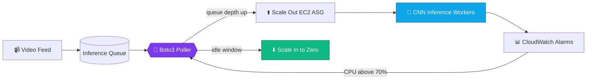
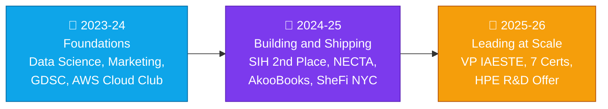

<!-- ===================== HEADER ===================== -->
<div align="center">


<a href="https://palakkumari-er.netlify.app/">
  
</a>

<br/>

<a href="https://palakkumari-er.netlify.app/"></a>
<a href="https://www.linkedin.com/in/palakkumari0604/"></a>
<a href="https://codolio.com/profile/Palak954"></a>
<a href="mailto:palakkumari1232604@gmail.com"></a>

<br/>


</div>

<br/>

<!-- ===================== WHOAMI ===================== -->
## 👩‍💻 `~/whoami`

```bash
palak@portfolio:~$ whoami
> Palak Kumari, final-year CSE (Cloud Computing, AWS) @ JECRC University | CGPA 8.36

palak@portfolio:~$ cat current_status.txt
> 🏢 Joining Hewlett Packard Enterprise (HPE) R&D, Bengaluru
> 🏆 Smart India Hackathon: 2nd place among 300+ national teams
> 👑 Vice President, IAESTE LC JECRC (46+ members, 29 global interns hosted)
> 🌍 Shipped production code for teams in Tanzania and Ghana

palak@portfolio:~$ ls skills/
> cloud/  backend/  distributed-systems/  dsa/  computer-vision/  leadership/

palak@portfolio:~$ echo $MOTTO
> Build with rigor. Lead with empathy. Never stop after a rejection.
```

<div align="center">

| 🎯 **17.5 LPA** | 📜 **7x** | 🧩 **839+** | 👥 **46+** | 📣 **177K+** |
|:---:|:---:|:---:|:---:|:---:|
| HPE R&D Offer | Industry Certs | DSA Problems | Members Led | Content Impressions |

</div>

---

<!-- ===================== TECH STACK ===================== -->
## 🧰 Tech Arsenal

<div align="center">


<br/>

<br/>


</div>

<details>
<summary><b>☁️ Cloud and DevOps</b> (click to expand)</summary>
<br/>

`AWS EC2` · `Auto Scaling Groups` · `S3` · `IAM` · `Lambda` · `CloudWatch` · `Boto3 SDK` · `CI/CD` · `Cloud Security`

</details>

<details>
<summary><b>⚙️ Backend and Databases</b></summary>
<br/>

`Java (SE 21)` · `C# .NET MVC` · `Django` · `Node.js / Express` · `REST APIs` · `SQL Server` · `MySQL` · `MongoDB`

</details>

<details>
<summary><b>🤖 AI, Data and Platforms</b></summary>
<br/>

`OpenCV` · `Keras / CNNs` · `Pandas` · `Matplotlib` · `Microsoft Fabric` · `ServiceNow CIS` · `JNCIA-Junos`

</details>

---

<!-- ===================== PROJECTS ===================== -->
## 🚀 Featured Projects

<table>
<tr>
<td width="50%" valign="top">

### 🤟 ISL Real-Time Converter
`🏆 SIH 2nd Prize`

Translates Indian Sign Language finger-spelling into **text and speech** in real time.

- 🎯 **94.8%** test accuracy (26 classes)
- ⚡ **30+ FPS** on edge devices
- 🧠 Custom CNN + OpenCV pipeline

`Python` `OpenCV` `Keras`

[**View Code →**](https://github.com/palakpk954/ISL-Converter-)

</td>
<td width="50%" valign="top">

### ☁️ AWS Auto-Scaling Inference
`⚙️ Cloud Automation`

Boto3 automation that scales EC2 inference workers with incoming video load.

- 💸 **65%** idle compute cost reduction
- 🛡️ **99.9%** uptime with failover
- 🔐 IAM least-privilege design

`AWS` `Boto3` `CloudWatch`

[**View Code →**](https://github.com/palakpk954/AWS-automation)

</td>
</tr>
<tr>
<td width="50%" valign="top">

### 🎯 Placement Helper: "You Can"
`🌐 Live App`

Interview-prep platform for engineering students: Java, DSA, OS, DBMS and System Design.

- 👥 Used by hundreds of students
- 📚 Company-wise prep guides
- 🌙 Mobile-first with dark mode

`JavaScript` `REST APIs` `Render`

[**Live Demo →**](https://placement-helper-you-can-1.onrender.com/) · [**Code →**](https://github.com/palakpk954/Placement_Helper-You_Can-)

</td>
<td width="50%" valign="top">

### 🌧️ Landslide Early-Warning Platform
`🥇 Regional Hackathon Top 10`

Geo-spatial dashboard that triggers evacuation alerts from rainfall thresholds.

- 🗺️ Leaflet + GeoJSON risk overlays
- 📶 Works in low-bandwidth zones
- 🔄 Offline caching via service workers

`JavaScript` `Leaflet` `PWA`

[**View Code →**](https://github.com/palakpk954/regional-risk-project)

</td>
</tr>
</table>

<div align="center">

🚚 **Also:** [Transport and Logistics Management System](https://github.com/palakpk954/transport_management) · Django · ACID bookings · dispatch scheduling · audit logging

</div>

### 🧬 How the AWS auto-scaling project works



---

<!-- ===================== JOURNEY ===================== -->
## 🛤️ The Journey



<details>
<summary><b>💼 Work experience: measurable impact (click to expand)</b></summary>
<br/>

| Role | Where | Impact |
|---|---|---|
| **Full Stack Web Dev Intern** | NECTA, Tanzania 🇹🇿 | Rebuilt .NET billing module: **-40% invoice time**, fixed discrepancies across **5,000+ records** |
| **Backend and Data Eng. Intern** | AkooBooks Audio, Ghana 🇬🇭 | **+25% page speed**, **+30% engagement**, **-20%** manual ops via Python pipelines |
| **Web Dev Intern** | DevBox Technologies, Jaipur 🇮🇳 | Shipped **5+ client sites**, fixed **30+** cross-browser and integration bugs |
| **Data Science Intern** | Psyliq, Remote | Pandas/Matplotlib dashboards: **+30%** reporting efficiency |

</details>

<details>
<summary><b>🎖️ Certifications: 7x certified (click to expand)</b></summary>
<br/>

- ☁️ AWS Certified **Solutions Architect – Associate**
- ☁️ AWS Certified **Developer – Associate**
- ☁️ AWS Certified **Cloud Practitioner**
- ☕ Oracle Certified Professional: **Java SE 21**
- 📊 Microsoft Certified: **Fabric Data Engineer Associate**
- 🛠️ ServiceNow **Certified Implementation Specialist** (CIS – Data Foundation)
- 🌐 **JNCIA-Junos** (HPE Juniper Networks)

**Plus:** 4x AWS Badges · Amazon ML Summer School 2026 · McKinsey Forward · Flipkart GRID R1 · SheFi Scholar (NYC)

</details>

<details>
<summary><b>👑 Leadership and community (click to expand)</b></summary>
<br/>

- **Vice President, IAESTE LC JECRC**: 46+ team, 29 global interns, 36+ offers released
- **Management Lead, AWS Cloud Club JU**: university-wide cloud bootcamps
- **Tech Masters India**: national community lead
- **Founder, Brify**: tech freelancing for small businesses
- **LinkedIn 4x Top Voice**: 11.8k+ followers, 177K+ impressions
- **Open Source**: GSSoC'24 and SSoC'25 contributor

</details>

---

<!-- ===================== STATS ===================== -->
## 📊 GitHub Analytics

<div align="center">


</div>

### 🧩 Problem solving

<div align="center">

| 🟢 Easy | 🟡 Medium | 🔴 Hard | 🔥 Max Streak | ⭐ LeetCode Rating |
|:---:|:---:|:---:|:---:|:---:|
| **320** | **415** | **104** | **80 days** | **1500** |

</div>

---

<!-- ===================== QUOTE ===================== -->
## 💭 The part people skip

> *"I was rejected by multiple companies before I was placed. I didn't stop. I practiced more, built more, and applied again. HPE and HCL Tech were the outcome."*

---

<!-- ===================== CONTACT ===================== -->
## 🤝 Let's Build Something Extraordinary

I'm open to **engineering roles, technical talks, open-source collabs, and student mentorship.**

<div align="center">

<a href="https://palakkumari-er.netlify.app/"></a>
<a href="https://www.linkedin.com/in/palakkumari0604/"></a>
<a href="https://codolio.com/profile/Palak954"></a>
<a href="mailto:palakkumari1232604@gmail.com"></a>

<br/><br/>


</div>
